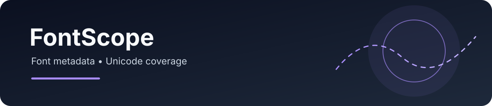

# FontScope

<p align="center"></p>

A zero-dependency TTF/OTF inspector for designers and developers. FontScope reads SFNT tables directly and reports useful font metadata without installing font libraries.

## Features
- Family, subfamily, full and PostScript names
- TrueType / OpenType format and OS/2 weight class
- SFNT table inventory
- Unicode character coverage and common script blocks
- CSS `@font-face` snippet generation
- Batch scan of font folders

## Run

Python 3.9+:

```bash
python app.py inspect ./fonts/Example.ttf
python app.py scan ./fonts --json font-report.json
python app.py scan ./fonts --css fonts.css
```

FontScope reads files only; it does not install or modify fonts. TTC collections and variable-font axis interpretation are not currently supported.